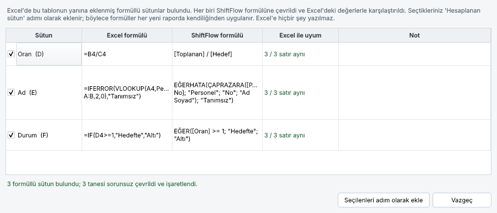
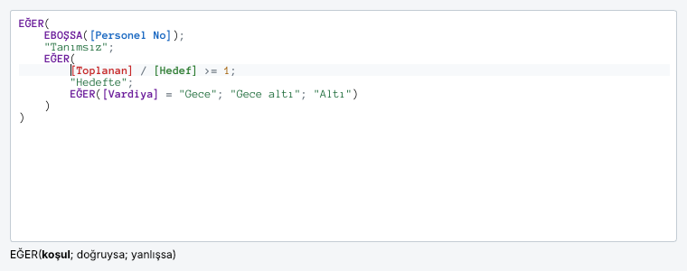
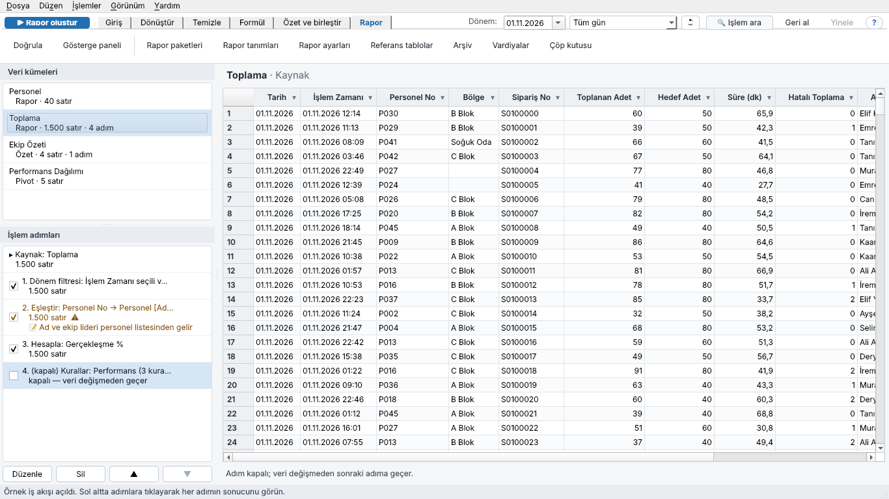
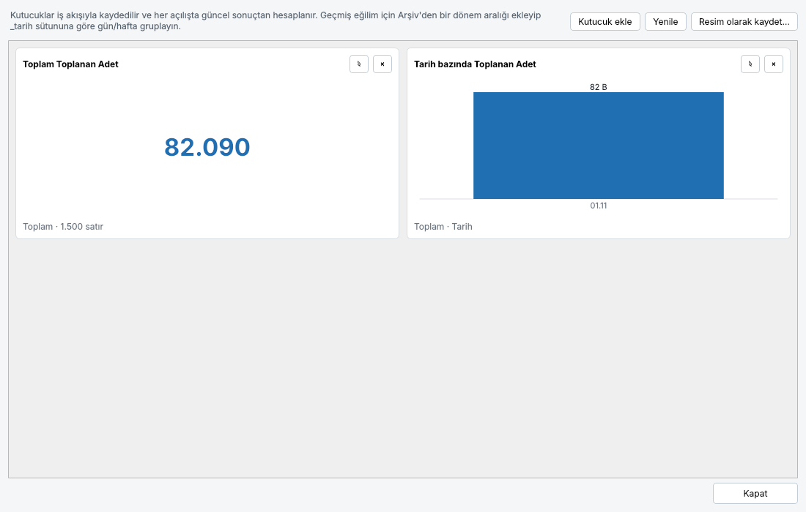

# ShiftFlow Kullanım Kılavuzu

## 1. Temel fikir

ShiftFlow'da tablodaki veriyi elle değiştirmezsiniz. Bunun yerine **adım** eklersiniz: "Bölge boş olanları çıkar", "Gerçekleşme % = Toplanan / Hedef × 100" gibi. Adımlar sırayla kaydedilir. Yarın yeni rapor geldiğinde aynı adımlar yeni veriye uygulanır.

Kaynak dosya hiçbir zaman değiştirilmez. Bir adım hata verirse uygulanmaz ve tablo eski hâlinde kalır.

## 2. Ekran

- **Üst çubuk (her zaman görünür):** ▶ Rapor oluştur, dönem seçimi, 🔍 İşlem ara (Ctrl+K), Geri al, Yinele.
- **Sekmeler (Excel şeridi gibi):** **Giriş** (veri al, akış aç/kaydet, Excel'e aktar) · **Dönüştür** (filtre, sırala, sütunlar, tip, böl, satırlara çevir) · **Temizle** (metin temizle, yazımı birleştir, tekrarlar, boş satırlar, aşağı doldur) · **Formül** (hesapla, koşullu, kurallar, DÜŞEYARA, Excel formülleri, parametreler) · **Özet ve birleştir** (grupla, pivot, birleştir, alt alta ekle) · **Rapor** (doğrula, rapor tanımları, ayarlar, referans tablolar, arşiv, vardiyalar). Son kullandığınız sekme hatırlanır.
- **Yardım:** **F1** kılavuzu açar; işlem pencerelerinde F1 veya **Yardım** düğmesi o işlemin bölümünü açar. Kılavuzda arama yapılabilir.
- **Veri kümeleri (sol üst):** Yüklediğiniz kaynaklar ve bunlardan ürettiğiniz birleştirme, pivot ve özetler. Her birinin satır sayısı görünür. Hatalı olan kırmızıdır.
- **İşlem adımları (sol alt):** Seçili veri kümesinin adımları. Her adımda satır değişimi görünür (örn. `1.500 → 1.475 satır`). ⚠ uyarı, ✖ hata demektir. Ayrıntı için fareyi üzerine getirin.
- **Tablo (orta):** Seçili veri kümesinin sonucu. Birden çok hücre seçince alt çubukta Sayı, Toplam ve Ortalama görünür (Excel'deki gibi).
  - **Ctrl+F:** Tabloda bul. Enter sonraki, Shift+Enter önceki, Esc kapatır; büyük/küçük harf fark etmez.
  - **Başlıktaki ▾:** O sütun için filtre penceresini açar (Excel'deki filtre oku gibi).
  - **Görünümde gizle:** Başlığa sağ tık → Görünüm → *Bu sütunu görünümde gizle*. Yalnız ekranda gizler; adım eklenmez, çıktıya yine yazılır.
  - **Sütun dondurma:** Başlığa sağ tık → Görünüm → *Sütunları buraya kadar dondur*. Soldaki sütunlar (örn. Personel No, Ad) sağa kaydırırken görünür kalır; *Dondurmayı kaldır* ile geri alınır.
- **Sütun bilgisi (sağ):** Her sütunun tipi, boş hücre sayısı ve farklı değer sayısı. Bir sütuna çift tıklayınca (veya başlıkta sağ tık → **Değer dağılımı…**) en sık 20 değer, adet ve yüzdesi; sayılarda en küçük/en büyük/ortalama/toplam görünür. Bir değere çift tıklamak yalnız o değeri gösteren filtreyi ekler.

## 3. Veri alma

| Yöntem | Nasıl |
|---|---|
| Excel / CSV | **Dosya aç** (Ctrl+O) veya dosyayı pencereye sürükleyin. Excel'de çalışma sayfasını seçin. |
| Kopyala-yapıştır | Excel'de hücreleri seçip Ctrl+C, ShiftFlow'da **Yapıştır** (Ctrl+V). |
| Klasördeki tüm dosyalar | Giriş → **Klasörden…**: klasör ve desen seçin (`toplama_*.xlsx`). Uyan dosyalar alt alta tek kaynak olur, her satıra **Kaynak dosya** sütunu yazılır. Desen kaydedilir: sonraki çalıştırmalarda klasör yeniden taranır, yeni günün dosyası kendiliğinden gelir. Sütunları farklı dosyalar uyarıyla birleştirilir. |
| Birden fazla kaynak | Yukarıdakileri tekrarlayın; her kaynak ayrı veri kümesi olur. |

Alma penceresinde "İlk satır sütun başlıklarıdır" seçeneği, kaynağın adı, satır/sütun sayısı ve sütun tipleri görünür. Türkçe sayı biçimi (`1.234,56`) ve tarihler (`31.12.2026`) otomatik tanınır. Başında sıfır olan kodlar (`00123`) metin olarak korunur.

## 4. İşlem ekleme

En hızlı yol, **sütun başlığına sağ tıklamaktır**: sırala, filtrele, boşları çıkar, yeniden adlandır, kaldır, tip dönüştür, metin temizle, bul-değiştir, tekrarları kaldır, grupla, pivot.

**Hücreye sağ tık:** "Yalnız bu değer olanları göster" veya "Bu değer olanları çıkar".

Araç çubuğundaki işlemler:

| İşlem | Ne yapar |
|---|---|
| Filtre | Koşullarla (VE/VEYA) veya Excel'deki gibi değer listesinden seçerek satır eler. |
| Sırala | Bir veya birden fazla sütuna göre sıralar. |
| Hesapla | Formülle yeni sütun (bkz. 4.1) |
| Koşullu | EĞER benzeri: koşul doğruysa bir değer, değilse başka bir değer yazar. |
| Eşleştir (DÜŞEYARA) | Başka bir tablodan anahtara göre değer getirir (bkz. 4.2) |
| Kurallar | Sırayla denenen kurallar; ilk uyan kuralın değeri yazılır (bkz. 4.3) |
| Dönem filtresi | Seçili vardiyaya/güne düşen satırları tutar (bkz. 9.5) |
| Sütunlar | Tutulacak sütunları ve sırasını seçer. |
| Ad değiştir | Sütun adlarını değiştirir. |
| Tip | Metin → sayı / tarih / metin dönüştürür; çevrilemeyen değerleri sayar. |
| Metin temizle | Boşluk temizler; BÜYÜK, küçük veya Baş Harf (Türkçe i/İ kurallarıyla). |
| Bul/Değiştir | Bir sütunda değer değiştirir (Ctrl+H). |
| Tekrarlar | Tekrarlı satırları kaldırır. |

**İşlemler → Biçim dönüştür** menüsünde (sütun başlığına sağ tıklayınca da var):

| İşlem | Ne yapar |
|---|---|
| Boş satırları kaldır | İşaretli sütunların hepsi boş olan satırları atar. Excel'de formüllerin verinin altına kadar çekildiği raporlarda formül sütunlarının işaretini kaldırın. |
| Aşağı doldur | Boş hücreye üstteki değeri yazar. Birleştirilmiş hücreli veya grup adını yalnız ilk satırda yazan WMS raporları için. |
| Boşları doldur | Boş hücrelere sabit değer yazar (sayıda 0, metinde "Tanımsız" gibi). |
| Sütunlara böl | Excel'deki "Metni sütunlara dönüştür": `A-01-03` → Bölge, Koridor, Raf. Ayırıcıya veya karakter sayısına göre. `01` gibi başında sıfır olan parçalar metin kalır. |
| Sütunları satırlara çevir | Yan yana duran `Gece / Gündüz / Akşam` sütunlarını iki sütuna indirir (`Vardiya`, `Adet`); sonra gruplanabilir. |
| Yazımı birleştir | Aynı değerin boşluk/harf farkıyla yazılmış hâllerini en sık yazılışa çevirir (bkz. 4.6). |

Her işlem penceresinde sonuç **siz yazarken önizlenir**: kaç satır kalacağı, uyarılar ve tablonun ilk satırları. Hata varsa sebebi yazılır ve "Uygula" düğmesi kapanır.

Filtre ve kural koşullarında bir sütunu başka bir sütunla karşılaştırmak için değere köşeli parantezle sütun adını yazın: `Toplanan` **büyük veya eşittir** `[Hedef]`.

### 4.1 Formüller

Excel'deki gibi yazılır. Sütun adları köşeli parantez içine alınır, fonksiyon bağımsız değişkenleri **`;`** ile ayrılır (Türkçe Excel'deki gibi). Başa `=` yazmak isteğe bağlıdır. Fonksiyon adları Türkçe veya İngilizce yazılabilir (EĞER / IF).

| Amaç | Örnek |
|---|---|
| Dört işlem, üs | `([Toplanan] - [Hedef]) / [Hedef] * 100`, `[A] ^ 2` |
| Koşul | `EĞER([Gerçekleşme %] >= 100; "Hedefte"; "Hedef altı")` |
| İç içe koşul | `EĞER([Süre] > 60; "Geç"; EĞER([Süre] > 40; "Normal"; "Hızlı"))` |
| Birden çok koşul | `EĞER(VE([Bölge] = "Soğuk Oda"; [Süre] > 40); "Gecikme"; "")`, ayrıca `YADA`, `DEĞİL` |
| Hata/boş yerine değer | `EĞERHATA([Toplanan] / [Hedef]; 0)`, `EBOŞSA([Lokasyon])` |
| Yuvarlama | `YUVARLA([Oran]; 1)`, `YUKARIYUVARLA`, `AŞAĞIYUVARLA`, `TAMSAYI`, `MUTLAK`, `MOD` |
| Satırdaki değerler arasında | `MAK([A]; [B]; 0)`, `MİN`, `TOPLA`, `ORTALAMA` |
| Metin | `SOLDAN([Lokasyon]; 3)`, `SAĞDAN`, `PARÇAAL([Kod]; 2; 3)`, `UZUNLUK`, `KIRP`, `BÜYÜKHARF`, `KÜÇÜKHARF`, `YAZIMDÜZENİ`, `YERİNEKOY`, `BİRLEŞTİR`, `[A] & "-" & [B]` |
| Sayıya çevirme | `SAYIYAÇEVİR([Miktar])` |
| Tarih/saat | `SAAT([İşlem Zamanı])`, `YIL`, `AY`, `GÜN`, `DAKİKA`, `HAFTANINGÜNÜ([Tarih]; 2)`, `HAFTASAY`, `BUGÜN()`, `ŞİMDİ()`, `TARİH(2026; 11; 10)` |
| Süre (dakika) | `([Bitiş] - [Başlangıç]) * 24 * 60` (iki tarihin farkı gün cinsindendir, Excel'deki gibi) |

| Başka tablodan getir | `DÜŞEYARA([Personel No]; "Personel"; 3; 0)` — tablonun ilk sütununda arar, 3. sütunu (veya sütun adını) getirir |
| Anahtar sütunu belirterek getir | `ÇAPRAZARA([Kod]; "Ürünler"; "Ürün Kodu"; "Kategori"; "Yok")` |
| Koşula uyan satır sayısı | `EĞERSAY("BU"; "Personel No"; [Personel No])` (kaç kez geçiyor), `ÇOKEĞERSAY("BU"; "Ekip"; [Ekip]; "Toplanan"; ">15")` |
| Koşula uyanların toplamı/ortalaması | `ETOPLA("BU"; "Ekip"; [Ekip]; "Toplanan")`, `ÇOKETOPLA(...)`, `ORTALAMAEĞER(...)` |
| Sütunun tablo geneli | `[Toplanan] / TABLOTOPLA("BU"; "Toplanan")` (pay), `TABLOORT`, `TABLOMAK`, `TABLOMİN`, `TABLOSAY` |
| Çok koşul | `ÇOKEĞER([Oran] >= 110; "Yüksek"; [Oran] >= 90; "Normal"; DOĞRU; "Düşük")` |
| Biçimli metin | `METNEÇEVİR([Oran]; "0,0%")`, `METNEÇEVİR([Tarih]; "gg.aa.yyyy")` |

**Tablo fonksiyonları:**
- Tablo adı tırnak içinde, veri kümeleri listesindeki gibi yazılır. İçinde bulunulan tablo için `"BU"` yazılır.
- Hepsi tek formülde iç içe kullanılabilir: `EĞER(EĞERHATA(DÜŞEYARA([Personel No]; "Personel"; 3; 0); "") = ""; "Tanımsız"; DÜŞEYARA([Personel No]; "Personel"; 2; 0) & " - " & [Bölge])`.
- Formülde adı geçen tablo bağımlılık olarak izlenir: değişince sonuç güncellenir, kullanıldığı sürece silinemez. Yeniden adlandırılınca formüldeki ad da güncellenir.
- Ölçütler Excel'deki gibi yazılır: `5`, `"Ege"`, `">5"`, `"<>İptal"`, `"A*"` (joker).
- Aramalar büyük/küçük harf ve baştaki/sondaki boşluk farkı gözetmez. Bulunamayan anahtarlar uyarıyla bildirilir; `EĞERHATA` ile korunmuşsa uyarı çıkmaz.

**Excel formülünü yapıştırma:**
1. Hesapla penceresinde **Excel formülü yapıştır…** düğmesine veya **İşlemler → Excel formülünden sütun…** menüsüne tıklayın.
2. Excel'deki formülü (`=EĞER(DÜŞEYARA(B2;Personel!A:C;3;0)…`) yapıştırın.

ShiftFlow formülü şöyle çevirir:
- **Hücre adresleri:** `C2` → `[Bölge]`. Harf eşlemesi pencerede görünür; tablo Excel'de A sütunundan başlamıyorsa "İlk sütun harfi"ni değiştirin.
- **Başka sayfalar:** `Personel!A:C` → `"Personel"` tablosu. Sayfa-tablo eşlemesi otomatik önerilir, değiştirilebilir.
- **Kalıplar:**
  - DÜŞEYARA, İNDİS+KAÇINCI, ÇAPRAZARA → `ÇAPRAZARA` (hangi sütunda aranıp hangisinin getirildiği açıkça yazar).
  - EĞERSAY, ÇOKEĞERSAY, ETOPLA, ÇOKETOPLA, ORTALAMAEĞER → tablo fonksiyonları.
  - `TOPLA(D:D)` → `TABLOTOPLA`; `TOPLA(D2:F2)` → `TOPLA([..]; [..]; [..])`.
- **Yazım:** Türkçe (`;`) ve İngilizce (`,`) Excel yazımı tanınır; İngilizce adlar Türkçeye çevrilir.
- **Çevrilemeyenler** uyarıyla gösterilir ve formülde `[?…]` olarak işaretlenir; tahminle tamamlanmaz. Örnekler: sabit hücreler (`$H$1` gibi parametre hücreleri), başka satıra başvurular (`D1`), DOLAYLI, KAYDIR.

Çevrilen formül, kaydedilmeden önce önizlemede bütün satırlar için hesaplanır.

**Sabit hücre → parametre:** Formülde `$H$1` gibi sabit bir hücre varsa **Parametre yap…** düğmesi çıkar. Ad ve değer verirsiniz; formülde `{Hedef Oran}` olur ve sonraki çevirilerde aynı hücre kendiliğinden bu parametreye bağlanır.

**Excel'e bırak:** ShiftFlow'da karşılığı olmayan bir formül (DOLAYLI, KAYDIR, TOPLA.ÇARPIM gibi) için **Excel'e bırak** düğmesi çıkar. Bu durumda sütun ShiftFlow'da boş görünür; çıktı dosyasına her satır için Excel formülü yazılır ve Excel dosyayı açınca hesaplar. Sütunların yeri değişse de (sıralama, sütun seçimi) formüldeki adresler çıktıdaki yeni yerlere göre yazılır. Sınırı: bu sütunun değeri ShiftFlow'daki sonraki adımlarda kullanılamaz.

**Excel'deki formüllü sütunları tek seferde almak:** **İşlemler → Excel'deki formüllü sütunları al…** (veya Ctrl+K → "formüllü sütun").
1. Kaynak tabloyu seçin; rapor Excel'de açık olsun veya kaynağın dosyası .xlsx olsun.
2. ShiftFlow sayfadaki başlık satırını bulur, ilk veri satırında `=` ile başlayan her sütunu okur ve çevirir.
3. Her çeviri, Excel'in hesapladığı değerlerle karşılaştırılır ("1.498 / 1.500 satır aynı"). Tamamen tutanlar işaretli gelir.
4. Formüller başka bir sayfayı kullanıyorsa (`Personel!A:C`) ve o sayfa yüklü değilse **Bu kitaptan yükle** ile tek tıkla yüklenir. Sabit listeler (personel, ürün) için "Referans tablo olarak kaydet" işaretli kalsın.
5. Sabit hücreler (`$H$1`) varsa yanındaki etiketle ("Hedef oran:") ve değeriyle **Parametre olarak tanımla** önerilir.
6. Uygula: seçilen sütunlar soldan sağa "Hesaplanan sütun" adımı olarak eklenir. Çevrilemeyenleri seçerseniz "Excel'e bırak" olarak eklenmesi önerilir.



**Formüller yalnız dolu satırlara uygulanır.** Excel'de formüller çoğu zaman verinin altına kadar (örn. 1000. satıra) çekilir; o satırlarda yalnız "Tanımsız" veya 0 gibi formül sonuçları vardır. ShiftFlow bu satırları tanır: pencerede "N satırda yalnız formül sonucu var" yazar, adımların başına **Boş satırları kaldır** ekler ve formülleri yalnız veri olan satırlara uygular. Ertesi gün 1.200 satırlık rapor gelirse formül 1.200 satıra uygulanır.

Hesapla penceresindeki **Yalnız dolu satırlar** seçeneği (yeni adımlarda açık) de aynı işi yapar: formüldeki sütunların hepsi boş olan satırda sonuç boş kalır.

Bu sütunlar artık ShiftFlow'da hesaplandığı için ertesi gün WMS'ten gelen ham raporda bulunmamaları "sütun eksik" uyarısı vermez. Excel'e hiçbir şey yazılmaz.

**Satırlar arası hesap** (satırların o anki sırasına göre; gerekirse önce Sırala adımı ekleyin):

| Amaç | Örnek |
|---|---|
| Önceki satırla fark (Excel'deki `=D3-D2`) | `[Sayaç] - ÖNCEKİ([Sayaç])`; personel bazında: `ÖNCEKİ([Sayaç]; 1; [Personel No])` |
| Sonraki satır | `SONRAKİ([Saat])` |
| Yürüyen toplam (`=TOPLA($D$2:D2)`) | `KÜMÜLATİF([Toplanan])`, grup içinde: `KÜMÜLATİF([Toplanan]; [Personel No])` |
| Kaçıncı tekrar (`=EĞERSAY($A$2:A2;A2)`) | `KÜMÜLATİF(1; [Sipariş No])` |
| Sıralama (`=RANK(D2;D:D)`) | `SIRA([Toplanan])` (1 = en büyük), küçükten: `SIRA([Süre]; 1)`, ekip içinde: `SIRA([Toplanan]; 0; [Ekip])` |

**Diğer fonksiyonlar (3.5):** ÇOKEĞERORTALAMA, MAKEĞER, MİNEĞER, BUL, MBUL, DEĞİŞTİR, YİNELE, METİNBİRLEŞTİR, ÖZDEŞ, ESAYIYSA, EMETİNSE, SEÇ, KAREKÖK, ÇARPIM, ORTANCA, BAĞ_DEĞ_SAY, BAĞ_DEĞ_DOLU_SAY, ZAMAN, SERİTARİH, SERİAY, İŞGÜNÜ, TAMİŞGÜNÜ, ETARİHLİ, TARİHSAYISI. Örnek: lokasyonun ilk tireden önceki kısmı `SOLDAN([Lokasyon]; BUL("-"; [Lokasyon]) - 1)`. SOLDAN/SAĞDAN/PARÇAAL'ın karakter sayısı artık satıra göre değişebilir.

**Parametreler** (Excel'deki `$H$1` gibi sabit hücreler): **Dosya → Parametreler** penceresinde ad ve değer tanımlayın (`Hedef Oran = 0,95`). Formülde süslü parantezle kullanın: `EĞER([Toplanan] / [Hedef] >= {Hedef Oran}; "Hedefte"; "Altı")`. Değeri değiştirince tüm formüller yeniden hesaplanır. Pencerede her parametrenin hangi adımlarda kullanıldığı görünür; kullanılan parametre silinemez.

Karşılaştırmalar `= <> < > <= >=` ile yapılır; metinlerde büyük/küçük harf fark etmez. Sıfıra bölme hücreyi boş bırakır ve uyarı verir; `EĞER` veya `EĞERHATA` ile korunmuş bölmeler için uyarı çıkmaz. Hesapla penceresindeki fonksiyon listesine çift tıklayarak fonksiyon ekleyebilirsiniz.

**Formül düzenleyici (Hesapla penceresi):**
- Formül kutusu çok satırlıdır; uzun formüller okunaklı yazılabilir. Satır sonları ve girintiler sonucu etkilemez.
- Renkler: fonksiyonlar mavi, `[sütunlar]` yeşil, metinler turuncu. İmleç bir parantezin yanındayken eşi vurgulanır.
- Yazarken fonksiyon ve sütun önerileri açılır; seçmek için Enter veya Tab.
- İmlecin bulunduğu fonksiyonun yazımı kutunun altında görünür ve sıradaki bağımsız değişken kalın yazılır. Örnek: `DÜŞEYARA(aranan; tablo; **sütun_no**; tam_eşleşme)`.
- **Düzenle** (Ctrl+Shift+F): iç içe formülü girintili satırlara böler. **Tek satır** formülü geri birleştirir. 90 karakterden uzun yapıştırılan Excel formülleri otomatik düzenlenir.
- **Seçimi dene:** Formülün bir parçasını (ör. içteki `DÜŞEYARA(...)`) seçip tıklayın; yalnız o parçanın sonucu önizlemede görünür. İç içe formülde hatayı bulmanın en kolay yolu budur.


- **Renkli sütunlar:** Formülde geçen her sütun farklı renkte yazılır; önizleme tablosunun başlığında ve sütun listesinde aynı renkle işaretlenir (Excel'deki renkli başvurular gibi). İmleci bir `[sütun]` üzerine getirince önizleme o sütuna kayar.
- **Excel'den yapıştırma:** Formül kutusuna `=B2*C2` gibi hücre adresli bir Excel formülü yapıştırırsanız ShiftFlow bunu tanır ve çevirme penceresini o formülle açar.
- Hata olduğunda yeri kırmızı dalgalı çizgiyle işaretlenir; mesajda satır ve karakter yazar. Kapanmamış parantezde hangi fonksiyonun parantezi olduğu söylenir.

### 4.2 Eşleştir (DÜŞEYARA)

Bir tabloya başka bir tablodan bilgi getirir. Örnek: toplama raporuna personel listesinden "Ekip Lideri", lokasyon listesinden "Bölge".

- **Arama tablosu:** Herhangi bir veri kümesi olabilir; en uygunu **referans tablolar**dır (bkz. 4.4).
- **Anahtar:** Bir veya birden fazla sütun çifti seçilir (örn. Depo + Lokasyon).
- **Getirilecek sütunlar:** İşaretlenir, istenirse yeni ad verilir.
- **Bulunamazsa:** Boş bırakılabilir veya "Tanımsız", 0 gibi bir değer yazılabilir.
- **Arama tablosunda tekrar varsa:** Excel gibi ilk bulunan alınır ve uyarı verilir; isterseniz "işlemi durdur" seçilir.

Excel'deki DÜŞEYARA'dan farkları:
- Satır sayısı **asla değişmez**.
- Büyük/küçük harf ve baştaki/sondaki boşluk fark etmez; `1` ile `1,0` aynı sayılır.
- Bulunamayan satırların sayısı ve örnekleri adım listesinde uyarı olarak görünür.
- Arama tablosu değişince sonuç kendiliğinden güncellenir.
- Arama tablosu kullanıldığı sürece silinemez.

### 4.3 Kural tablosu

Çok sayıda koşul için iç içe EĞER yazmak yerine kullanılır. Kurallar yukarıdan aşağıya denenir; bir satıra **ilk uyan** kuralın değeri yazılır, hiçbirine uymayanlara "Hiçbiri uymazsa" değeri yazılır.

```
1) Hedef Adet = 0                                → Hedef yok
2) Gerçekleşme % ≥ 110                           → Yüksek
3) Gerçekleşme % < 80 VE Hatalı Toplama > 0      → Kontrol et
Hiçbiri uymazsa                                  → Normal
```

Değer düz metin, sayı veya formül olabilir (`[Miktar] * 2`). Kurallar ▲ ▼ ile sıralanır. Hiçbir satıra uygulanmayan kural uyarıyla bildirilir (genelde üstteki bir kural o satırları almıştır).

### 4.4 Referans tablolar

Raporla her gün gelmeyen ama eşleştirmede kullanılan sabit veriler: lokasyon → bölge, ürün → kategori, personel → ekip.

- **Ekleme:** **Referans tablolar** → **Yeni…** → dosyadan, panodan veya açık Excel'den. Kaydedilen tablo **İş akışına ekle** ile kaynak olur. Veri kümelerinde "Referans: …" yazar.
- **Mevcut kaynaktan:** Eklenmiş bir kaynağı referans tabloya çevirmek için veri kümesine sağ tıklayın → **Referans tablo olarak kaydet…**
- **Kullanım:** Rapor oluştururken referans tablolar her seferinde kütüphaneden otomatik okunur; dosya seçmek gerekmez.
- **Güncelleme:** Veri değişince **İçeriği yenile…** seçin; bağlı tüm iş akışları bir sonraki çalıştırmada yeni içeriği kullanır. Yeni içerikte eksik sütun varsa uyarılırsınız.
- **Saklama:** Referans tabloları bu bilgisayarda saklanır, iş akışı dosyasına yazılmaz. Başka bir bilgisayarda aynı adla yeniden eklenmeleri gerekir.

### 4.5 İşlem ara (Ctrl+K)

Hangi menüde olduğunu hatırlamadığınız her işlem için **🔍 İşlem ara**'ya (Ctrl+K) basın ve ne yapmak istediğinizi yazın: "düşeyara", "boş", "tekrar", "yuvarla", "vardiya", "pivot", "mail"…
- Türkçe karakter yazmasanız da bulunur ("dusey").
- Eş anlamlılar da tanınır: "vlookup", "mükerrer", "merge".
- Bir sütun seçiliyse ona uygun işlemler öne çıkar.
  - **Sayı sütununda:** "Toplam içindeki pay %", "Yuvarla", "Ortalamanın üstünde mi".
  - **Tarih sütununda:** "Saat", "Dönem filtresi".
  - **Metin sütununda:** "Boşlukları temizle", "Başka tablodan getir".
- Hazır formüller Hesapla penceresini formülü doldurulmuş olarak açar.
- ↑↓ ile seçin, Enter ile uygulayın.

### 4.6 Aynı değerin farklı yazılışları (boşluk / harf)

"Ege", "Ege " ve "ege" Excel'de olduğu gibi ShiftFlow'da da ayrı değerlerdir. Filtre, gruplama, pivot, tekrar kontrolü veya karşılaştırma içeren bir formül eklediğinizde ShiftFlow bu sütunda farklı yazılış bulursa uyarır ve sorar:

- **Düzelt:** Adımın önüne **Yazımı birleştir** adımı eklenir. Her farklı yazılış, o değerin en sık kullanılan yazılışına çevrilir. Kaynak dosya değişmez; adım her yeni raporda yeniden uygulanır.
- **Şimdi değil:** Değer olduğu gibi kalır. Uyarı adım listesinde ⚠ olarak görünmeye devam eder.
- **Bu adım için bir daha sorma.**

Gruplama ve pivotta düzeltme adımı girdi tablosunun sonuna eklenir. Eşleştir (DÜŞEYARA) zaten boşluk ve harf farkını gözetmez; orada soru çıkmaz.

### 4.7 Doğrulama (rapor dağıtılmadan önce kontrol)

**Rapor → Doğrula** adımı veriyi değiştirmez, yalnız kontrol eder:

| Kontrol | Örnek |
|---|---|
| Boş olmasın | `Personel No` hiçbir satırda boş olmasın |
| Tekrar etmesin | `Sipariş No` bir kez geçsin |
| En az satır sayısı | Rapor en az 100 satır olsun (eksik indirilmiş raporu yakalar) |
| Değer aralığında olsun | `Gerçekleşme %` 0 ile 300 arasında; sınır parametre olabilir: `{Üst Sınır}` |
| Formül her satırda doğru olsun | `[Toplanan] <= [Hedef] * 2`, `EĞERHATA(DÜŞEYARA([Kod]; "Ürünler"; 2; 0); "") <> ""` |

Her kontrol için **Sağlanmazsa** seçin:
- **Uyar:** Rapor oluşur, uyarı özette görünür.
- **Raporu durdur:** Rapor oluştur (F9) ve Excel'e aktar çıktı yazmaz; sebebi ve ilk satır numaraları gösterilir. Düzenlerken bu kontroller ⛔ uyarısı olarak görünür, adım eklemeyi engellemez.

## 5. Adımları yönetme

- **Ara sonuç:** Adım listesinde bir adıma tıklayın. Tablo o adımdaki hâli gösterir ve sarı bir uyarı çıkar. Bu sırada eklediğiniz yeni işlem o adımın hemen arkasına girer.
- **Düzenle:** Adıma çift tıklayın veya "Düzenle"ye basın. Pencere mevcut ayarlarla açılır.
- **Sil, ▲ ▼ (sırayı değiştir):** Değişiklik bir sonraki adımı bozacaksa (örn. "Fark" sütununu kullanan filtreyi, sütunun oluşturulmasından önceye taşımak) değişiklik reddedilir ve sebebi gösterilir.
- **Geri al / Yinele:** Ctrl+Z / Ctrl+Y. Silinen adım ve veri kümesi de geri gelir.
- **Adımı geçici kapatma:** Adımın yanındaki onay kutusunu kaldırın. Adım silinmez; veri değişmeden sonraki adıma geçer (gri ve "kapalı" yazar). Etkisini görmek için kapatıp açabilirsiniz. Sonraki bir adım o adımın ürettiği sütunu kullanıyorsa kapatma reddedilir.
- **Adım notu:** Adıma sağ tık → **Not ekle/düzenle…** ("WMS'teki iptal satırlarını çıkarır"). Not adım listesinde 📝 ile görünür ve iş akışıyla kaydedilir.
- **Kopyasını ekle:** Sağ tık → aynı ayarlarla hemen arkasına yeni adım (hesaplanan sütunlarda ad "(kopya)" olur).



**Uzun işlemler:** İşlem birkaç saniyeden uzun sürerse pencere donmaz; hangi adımın hesaplandığını gösteren bir pencere açılır. **İptal**'e basarsanız çalışan adım bitince durur ve yarım kalan değişiklik geri alınır. Bu sırada pencerenin geri kalanı tıklanmaz.

**Otomatik yedek:** Kaydedilmemiş değişiklikler birkaç saniyede bir bu bilgisayarda gizli bir klasöre yedeklenir (veriler dahil; ağa gönderilmez). ShiftFlow düzgün kapatılmadan (çökme, elektrik kesintisi) kapanırsa bir sonraki açılışta "Kurtarılmış iş akışı" önerilir. Kaydedince, yeni çalışma açınca veya kapatırken "Kaydetme" deyince yedek silinir.

Bir değişiklik, o veri kümesini kullanan başka bir veri kümesini (örn. bir pivotu) bozacaksa da reddedilir ve bozulacak veri kümesinin adı söylenir.

## 6. Birleştirme ve alt alta ekleme

**Birleştir:** Sol ve sağ veri kümesini, birleştirme türünü ve anahtar sütunları seçin. Aynı adlı sütun otomatik önerilir. Birden fazla anahtar eklenebilir (örn. Depo + Lokasyon).

| Tür | Sonuç |
|---|---|
| Sol | Soldaki tüm satırlar; eşleşmeyenlerin sağ sütunları boş kalır |
| İç | Yalnız iki tarafta da eşleşen satırlar |
| Tam | Her iki taraftaki tüm satırlar |

Uygulamadan önce pencerede şunlar görünür: ilişki türü (bire-bir, bire-çok…), her iki taraftaki eşleşen ve eşleşmeyen satır sayısı, tekrar eden anahtarlar ve sonuçtaki beklenen satır sayısı.

Korumalar:
- `1`, `1,0` ve `" 1 "` aynı anahtar sayılır. `001` ile `1` aynı sayılmaz (kod olarak farklıdır).
- Anahtarı boş olan satırlar birbiriyle eşleşmez.
- **Çoktan-çoğa** eşleşmede satırlar çoğalır. Uygulama bunu sessizce yapmaz, onayınızı ister.
- Hiç eşleşme yoksa iki taraftan örnek değerlerle uyarır.
- Aynı adlı sütunlara sağ veri kümesinin adı eklenir: `Adet (Stok)`.
- "Eşleşme Durumu sütunu ekle" seçilirse her satırda *Eşleşti / Yalnız solda / Yalnız sağda* yazar. Bu sütunla eşleşmeyenleri ayrı bir kontrol listesine filtreleyebilirsiniz.

**Alt alta ekle:** Aynı biçimdeki raporları (örn. üç vardiyanın raporu) tek listede toplar. İsterseniz satırın hangi kaynaktan geldiğini yazan bir sütun eklenir.

## 7. Grupla ve Pivot

**Grupla:** Seçili sütunların her farklı değer birleşimi için bir satır oluşturur ve toplam, adet, ortalama, min, maks veya benzersiz adet hesaplar.

**Pivot:** Alanları "Satıra" veya "Sütuna" ekleyin (düğmeyle veya **sürükleyip bırakarak**), değer alanlarını ve hesaplamayı seçin. Birden fazla satır alanı ve birden fazla değer alanı desteklenir. Genel toplam isteğe bağlıdır. Boş grup alanları "(Boş)" başlığında toplanır.

Grupla ve Pivot pencerelerindeki seçenekler:
- **Tarih alanlarını grupla:** Saat (`08:00`), Gün, Hafta (`2026-H46`), Ay (`2026-11`), Yıl, Haftanın günü (`2 Sal`). Saatlik vardiya kırılımı için yardımcı sütun gerekmez.
- **Değerleri göster (pivot):** Değer, Genel toplamın %'si, Satır toplamının %'si, Sütun toplamının %'si.
- **Değere göre sırala** (büyükten küçüğe) ve **Yalnız ilk N satır** (örn. en çok toplayan 10 personel). İlk N seçiliyken Genel Toplam yalnız gösterilen satırların toplamıdır.

İkisi de **yeni bir veri kümesi** oluşturur. Kaynak veri kümesine sonradan adım eklerseniz pivot otomatik güncellenir.

Aynı veriden farklı kollar oluşturmak için veri kümesine sağ tıklayıp **Kopyasını oluştur**'u seçin.

## 8. İş akışını kaydetme ve yeni raporla çalıştırma

1. **Akışı kaydet** (Ctrl+S): Adımlar JSON dosyasına kaydedilir. Bu dosyada **veri yoktur**, yalnızca işlem tanımları vardır.
2. Ertesi gün **Akış aç** → "Kaynakları bağla" penceresi açılır:
   - WMS raporu her gün aynı yola yazıyorsa **Kayıtlı yollardan yükle** yeterlidir.
   - Farklı bir dosya için **Dosya seç…**, panodan almak için **Yapıştır** kullanın.
3. **Çalıştır** → tüm veri kümeleri yeniden hesaplanır. Hata olan veri kümeleri listelenir.
4. Kayıtlı bir çıktı listesi varsa çıktıyı hemen Excel'e aktarmak isteyip istemediğiniz sorulur.

Açık bir akışta yeni veri almak için: **Yeni verilerle çalıştır** (F5).

**Rapor biçimi değişirse:** Örneğin `Toplanan Adet` sütunu `Toplanan Miktar` olarak gelirse "Sütun eşleme" penceresi açılır. Uygulama benzer adı kendisi önerir; siz onaylarsınız. Eşleme iş akışına kaydedilir ve bir sonraki raporda tekrar sorulmaz. Tipi değişen sütunlar da (sayı → metin gibi) aynı pencerede uyarı olarak gösterilir.

## 9. Açık raporlar ve ▶ Rapor oluştur

Bu bölüm günlük kullanımın kısa yoludur. WMS raporu Excel'de açar (çoğu zaman kaydetmeden, "Kitap1" gibi bir adla). ShiftFlow açık kitapları tarar, raporu tanır, iş akışını çalıştırır ve çıktıyı oluşturur.

### 9.1 Raporu bir kez tanımlayın

1. WMS'ten raporu alın; Excel'de açık kalsın.
2. ShiftFlow'da **Açık Excel'den al** (Ctrl+Shift+E). Açık tüm kitaplar listelenir; kaydedilmemiş olanlar "(kaydedilmemiş)" diye işaretlenir.
3. Raporun sayfasını seçin. Başlık satırı otomatik bulunur. Rapor üstünde başlık veya tarih satırları varsa atlanır; gerekirse "Başlık satırı" kutusundan düzeltin.
4. **Rapor olarak tanımla…** → raporu adlandırın (örn. *WMS Toplama Performans Raporu*).
   - **Tanıma sütunları:** Her gün mutlaka gelen sütunları işaretli bırakın. Bazen gelmeyen sütunların işaretini kaldırın.
   - **Kitap/sayfa adı ipucu** (isteğe bağlı): İki farklı raporun sütunları çok benziyorsa kullanın.
5. **Veri olarak al** → rapor kaynak olarak eklenir ve tanıma bağlanır. Veri kümeleri listesinde "Rapor: …" yazar.

Tanımlar bilgisayarınızdaki rapor kütüphanesinde tutulur (**Rapor tanımları** menüsü). Aynı rapor birden çok iş akışında kullanılabilir; bir kez tanımlamak yeterlidir.

Zaten dosyadan eklediğiniz bir kaynağı tanıma bağlamak için veri kümesine sağ tıklayın: **Bu kaynaktan rapor tanımı oluştur…** veya **Rapor tanımına bağla…**

### 9.2 Senaryoyu kurun ve kaydedin

İşlemleri, birleştirmeleri ve pivotları her zamanki gibi ekleyin. **Excel'e aktar** penceresinde çıktı sayfalarını seçip "Bu seçimi iş akışına kaydet"i işaretleyin. Ardından **Akışı kaydet** (Ctrl+S).

İlk **Rapor oluştur**'da **Rapor ayarları** sorulur (Çıktı, Arşiv, Şablon, Mail sekmeleri; sonradan Dosya → Rapor ayarları…):
- Klasör (örn. ortak klasördeki *Günlük Raporlar*).
- Dosya adı kalıbı. Varsayılan `{akis} {tarih} {vardiya}` → `Vardiya sonu raporu 2026-11-10 Gündüz.xlsx`.
- Aynı adlı dosya varsa üzerine yazılmaz.

### 9.3 Her gün

1. WMS'ten raporları alın (Excel'de açık kalsınlar).
2. ShiftFlow'da **Akış aç**. Açık raporlar hemen bulunur ve veriler yüklenir.
3. Araç çubuğundaki **Dönem**'i kontrol edin; otomatik gelir, gerekirse değiştirin (bkz. 9.5).
4. **▶ Rapor oluştur** (F9). Her şey yolundaysa çıktı doğrudan oluşur, açılır, arşivlenir. Mail açıksa önizleme gelir.

### 9.4 Değişiklik yakalama

Karar gerektiren bir durum varsa önce **kaynak kontrolü** ekranı açılır. "Raporu oluştur" düğmesi, tüm satırlar hazır olunca etkinleşir.

| Durum | Ne oldu | Ne yapılır |
|---|---|---|
| ✓ Hazır | Sorun yok | — |
| ✓ Hazır (değişiklik var) | Yeni sütun geldi, sıra değişti, yazım farkı (büyük/küçük harf) otomatik eşlendi veya bir sütunun tipi değişti | Bilgi amaçlı; ayrıntı alt kutuda |
| ⚠ Sütun eşleme gerekli | Kullanılan bir sütun gelmedi (adı değişmiş olabilir) | **Sütunları eşle…** Önerilen karşılık seçili gelir. Eşleme rapor tanımına kaydedilir ve bir daha sorulmaz. |
| ⚠ Birden çok uygun rapor | Aynı rapordan iki kitap açık (örn. dünkü ve bugünkü) | **Raporu seç…** |
| ⚠ Son çalıştırmayla aynı veri | Rapor bir önceki başarılı çalıştırmadakiyle birebir aynı; WMS'ten yenisi alınmamış olabilir | Yeni raporu açıp **Yeniden tara** veya **Yine de bu veriyi kullan** |
| ✖ Açık rapor bulunamadı | Rapor açık değil | Raporu açıp **Yeniden tara** veya **Dosya seç…** |

İş akışındaki herhangi bir veri kümesi hata verirse çıktı dosyası **oluşturulmaz**; hatalar listelenir. Eksik veya yanlış rapor dağıtılmaz.

Her çalıştırma **Rapor tanımları → Çalıştırma geçmişi**'ne kaydedilir: zaman, sonuç, çıktı yolu veya hata. Geçmişte veri değil, yalnızca satır sayısı ve içerik özeti tutulur.

Excel "meşgul" uyarısı alırsanız (Excel'de bir hücre düzenleniyordur veya bir pencere açıktır) Excel'de Enter veya Esc'e basıp tekrar deneyin. ShiftFlow açık kitaplarda hiçbir şeyi değiştirmez, kaydetmez, kapatmaz.

### 9.5 Dönem (tarih + vardiya)

Araç çubuğunda **Dönem** seçimi vardır: tarih ve vardiya (veya "Tüm gün").

- **Varsayılan:** Saate göre otomatik hesaplanır ve "(otomatik)" yazar. Değiştirirseniz "(elle seçildi)" olur; **Otomatik** düğmesi varsayılana döndürür.
- **Varsayılanın hesabı:** Yeni vardiya başladıktan sonraki ilk 2 saat içinde (süre ayarlanabilir) varsayılan, **biten** vardiyadır. Örnek: 16:40'ta varsayılan 08:00–16:00 vardiyasıdır, çünkü vardiya sonu raporu biten vardiya için hazırlanır.
- **Vardiya tanımları:** **Dosya → Vardiyalar…** ile bir kez tanımlanır. Varsayılan: Gece 00–08, Gündüz 08–16, Akşam 16–24. Gece yarısını geçen vardiya (22:00–06:00) desteklenir; vardiyanın tarihi başladığı gündür.
- **Seçili dönemin etkileri:**
  - **Dönem filtresi** adımı: rapor bütün günü içeriyorsa, işlem zamanı seçili vardiyaya düşen satırları tutar. Adımın içine saat yazılmaz; aynı iş akışı her vardiya için çalışır.
  - **Dosya adı ve mail konusu:** `{tarih}`, `{vardiya}`, `{donem}`.
  - **Arşive yazma ve arşivden okuma** (önceki vardiya vb.).

### 9.6 Rapor arşivi ve geçmiş

**Rapor ayarları → Arşiv** sekmesinde "Her Rapor oluştur sonucunu arşive yaz" açılır. Hangi veri kümelerinin arşivleneceği seçilir; hiç seçim yapılmazsa çıktı sayfaları arşivlenir.

- Her çalıştırmanın sonucu dönemiyle (tarih + vardiya) bu bilgisayardaki arşive yazılır.
- Aynı dönem yeniden oluşturulursa sorulur. "Evet" derseniz eski kayıt değiştirilir (çift kayıt olmaz).
- Rapor biçimi zamanla değişirse yeni sütunlar eklenir; eski dönemlerde boş görünür.

**Arşivi kullanma:** **Arşiv** → küme seçin → aralık seçin → **Kaynak olarak ekle**. Aralıklar seçili döneme göre her çalıştırmada yeniden hesaplanır.

| Aralık | Ne gelir |
|---|---|
| Önceki vardiya | Seçili vardiyadan bir önceki vardiya |
| Dünün aynı vardiyası | Bir önceki günün aynı vardiyası |
| Önceki gün | Önceki günün tüm vardiyaları |
| Önceki N gün | Seçili günden önceki N gün |
| Bu ay | Ayın ilk gününden seçili güne |
| Tarih aralığı / Tüm arşiv | Sabit aralık / hepsi |

Arşivden gelen tabloda **Tarih** ve **Vardiya** sütunları vardır.
- **Karşılaştırma:** Ekip Özeti'ne arşivdeki önceki vardiyayı Eşleştir (DÜŞEYARA) ile getirip `[Bugün] - [Önceki]` farkını hesaplayın.
- **Trend:** "Önceki 30 gün"ü kaynak olarak ekleyip Tarih'e göre pivot yapın.

Arşivde o döneme ait kayıt yoksa (örn. ilk gün) boş tablo kullanılır ve uyarı verilir; rapor durmaz. Arşiv penceresinden dönem veya küme silinebilir.

### 9.7 Vardiya maili

**Rapor ayarları → Mail** sekmesinde ayarlanır:
- **Alıcılar:** Kime, Bilgi, Gizli (adresleri `;` ile ayırın). İsteğe bağlı olarak **vardiyaya göre ek alıcılar** (örn. gece vardiyası lideri).
- **İçerik:** Konu ve metin (`{akis} {vardiya} {tarih} {donem}` kullanılabilir). Mail içine tablo olarak eklenecek veri kümesi (örn. Ekip Özeti, en fazla N satır). Excel çıktısını ekleme seçeneği.

Rapor oluşunca **mail önizlemesi** açılır. Alıcılar ve konu burada son kez düzeltilebilir.
- **Outlook'ta taslak olarak aç:** Outlook penceresinde açılır, gönderimi siz yaparsınız.
- **Gönder…:** Alıcı listesi gösterilip onay istenir; onaylamadan gitmez.
- **.eml olarak aç:** Outlook'a bağlanılamazsa kullanılır. Dosya Outlook'ta düzenlenebilir taslak olarak açılır.

Mail **hiçbir zaman** onayınız olmadan gönderilmez. Outlook kendi hesabınızla çalışır; ShiftFlow parola saklamaz.

### 9.8 Grafik ve şablon

**Excel'e aktar** penceresinde her sayfa için **Grafik ekle…** ile gerçek bir Excel grafiği eklenir: sütun, yatay çubuk, çizgi veya pasta.
- "Genel Toplam" satır ve sütunları grafiğe katılmaz.
- Değer sütunu seçilmezse tüm sayısal sütunlar kullanılır. Pivot sütunları her gün değişebiliyorsa (örn. bloklar) bu seçeneği kullanın.

**Şablon** (Rapor ayarları → Şablon): kendi Excel dosyanızı (başlık, renkler, sütun genişlikleri, formüllü özet hücreleri) seçin.
- Excel'e aktar'daki sayfa adı şablondaki bir sayfayla aynıysa tablo oraya, "Başlangıç" hücresinden (örn. A5) itibaren yazılır.
- Şablondaki **formüller korunur** ve Excel açılınca yeni veriyle hesaplanır. Özet rakamları şablonda formülle kurabilirsiniz.
- Belirli hücrelere `{vardiya} vardiyası – {tarih}` gibi metinler yazdırılabilir.
- Sınır: şablondaki resimler (logo), hazır grafikler, PivotTable'lar ve makrolar korunamaz; ShiftFlow bunları şablon seçerken uyarır. Grafikleri ShiftFlow'un grafik özelliğiyle ekleyin.

### 9.9 Rapor paketleri

Vardiya sonunda birden çok rapor (Toplama, Sevkiyat, Stok…) hazırlıyorsanız: **Rapor → Rapor paketleri…**
1. **İş akışı ekle** ile kayıtlı iş akışlarını sırayla ekleyin ve paketi kaydedin (`.sfpaket.json`).
2. Dönemi seçin, **▶ Paketi çalıştır**. Her iş akışı açık raporlardan/dosyalardan verisini bulur ve çıktısını oluşturur.
3. Sonuç penceresinde her akışın durumu görünür. Kaynağında karar gerektiren bir sorun olan (sütun eşleme, iki aday rapor, rapor bulunamadı, aynı veri) akış **atlanır**; diğerleri çalışmaya devam eder. **Akışı aç** ile o akışı açıp her zamanki gibi çözersiniz.
4. **Tek mail:** "Tüm çıktıları tek mailde gönder" açıksa bütün dosyalar tek taslağa eklenir; özet de mailde yazar. Kapalıysa her akışın kendi mail ayarı kullanılır. Gönderim yine sizin onayınızla yapılır.

Ayarlar: bir akış oluşturulamazsa kalanları durdurma; dönem arşivde varsa değiştirme veya arşive yazmama.

### 9.10 Gösterge paneli

**Rapor → Gösterge paneli:** İş akışının veri kümelerinden kutucuklar: **Sayı** (toplam toplanan, personel sayısı), **Sütun / Çubuk / Çizgi grafiği**, **Tablo**. Her kutucukta veri kümesi, gruplama sütunu, değer, hesaplama, tarih gruplama ve "ilk N" seçilir. Kutucuklar iş akışıyla kaydedilir ve her açılışta güncel sonuçtan hesaplanır. **Resim olarak kaydet** paneli PNG yapar (maile veya sunuma eklemek için).

Geçmiş eğilim için: **Arşiv**'den "son 30 gün" gibi bir aralığı kaynak olarak ekleyin, kutucukta yatay ekseni `_tarih` ve tarih gruplamayı Gün/Hafta seçin.



Panel bu bilgisayarda çalışır. Ekibin ortak bir panelden canlı izlemesi istenirse veriler bir sunucuda (şirket sunucusu veya VPS) tutulmalıdır; bu ayrı bir aşamadır.

### 9.11 Çöp kutusu

Silinen **rapor tanımları**, **referans tablolar** ve **arşiv dönemleri/kümeleri** 30 gün **Rapor → Çöp kutusu**'nda durur ve **Geri yükle** ile geri gelir. Üzerine yazılan kayıtlar da burada saklanır: referans tablonun içeriği yenilendiğinde eski içerik, arşivde aynı dönem yeniden oluşturulduğunda eski dönem. Aynı adla yenisi varsa geri gelen kaydın adına "(geri)" eklenir; hiçbir şey kendiliğinden silinmez. 30 günden eski kayıtlar açılışta temizlenir.

İş akışındaki adım ve veri kümesi silmeleri zaten **Geri al** (Ctrl+Z) ile geri alınır.

### 9.12 Otomasyon: zamanlanmış çalıştırma ve WMS teşhisi

**Otomasyon** sekmesinde üç araç var.

**Zamanlanmış görev:** Rapor paketini (veya tek iş akışını) her vardiya bitiminden belirli bir süre sonra, örneğin 15 dakika sonra, pencere açmadan çalıştırır.
1. Paketi veya iş akışını seçin. Süreyi ve mail biçimini seçin: *Outlook Taslaklar klasörüne kaydet* veya *.eml dosyası*. Mail hiçbir zaman kendiliğinden gönderilmez.
2. **Şimdi bir kez dene** ile hemen çalıştırıp sonucu görün.
3. **Görevleri oluştur** her vardiya için Windows Görev Zamanlayıcı'ya bir görev ekler. Komutları kopyalayıp kendiniz de çalıştırabilirsiniz.
4. Her çalıştırmanın sonucu `%LOCALAPPDATA%\ShiftFlow\calistirma_gunlugu.txt` dosyasına yazılır. Atlanan veya hatalı rapor varsa "ShiftFlow uyarısı" adlı bir mail taslağı da hazırlanır.

Koşullar:
- Bilgisayar açık ve Windows oturumunuz açık olmalı; ekran kilitli olabilir.
- Raporlar o saatte dosya veya klasör kaynağından ya da Excel'de açık kitaplardan alınır.
- WMS'te raporu kendiliğinden açma adımı ekran otomasyonuyla eklenecek (aşağıdaki teşhise bağlı).

Komut satırından da çalıştırılabilir:
```
ShiftFlow.exe --paket "Vardiya sonu.sfpaket.json" --donem otomatik --mail outlook
ShiftFlow.exe --akis "Toplama.json" --donem 2026-11-10:Gece --mail eml
```
Çıkış kodları: 0 = hepsi oluşturuldu, 1 = bazıları atlandı, 2 = çalıştırılamadı.

**WMS ekranını incele:** WMS'i açın ve raporu çalıştıracağınız ekrana gelin; en iyisi filtre penceresi açıkken. Ardından pencereyi listeden seçip **İncele**'ye basın.
- ShiftFlow menü, düğme ve alanların adlarını okur: Windows UI Automation ve klasik Win32 yöntemleriyle.
- Hiçbir şeye tıklamaz, yazmaz. Alanların içeriği ve tablo verisi okunmaz; rapor yalnız bu bilgisayara kaydedilir.
- Sonuç üç türlü olur: **UYGUN** (ekran otomasyonu güvenle kurulabilir), **KISMEN UYGUN** veya **UYGUN DEĞİL** (yalnız ekran konumuna göre tıklanabilir; önerilmez).
- Teknoloji tahmini de gösterilir (.NET, WPF, Java, Delphi, PowerBuilder, Citrix…).
- **Özeti kopyala** yalnız sayıları ve sonucu kopyalar; kontrol ağacını kopyalamaz.

## 10. Excel'e aktarma

**Excel'e aktar** (Ctrl+E): Aktarılacak veri kümelerini ve sayfa adlarını seçin. Her veri kümesi ayrı sayfaya yazılır; başlıklar kalın ve ilk satır sabittir. "Bu seçimi iş akışına kaydet" işaretliyse sonraki çalıştırmalarda aynı çıktı kullanılır. Çıktı dosyası bir kaynak dosyayla aynı olamaz.

**Biçim…** düğmesi (her sayfa için):
- **Toplam satırı:** Tablonun altına sayı sütunlarının toplamı yazılır (`ALTTOPLAM`); Excel'de filtre uygulanınca yalnız görünen satırları toplar.
- **Koşullu renk:** Örn. `Gerçekleşme %` *küçüktür* `{Hedef Oran}` → kırmızı; `Durum` *eşittir* `Gecikme` → sarı, **tüm satırı boya**. Excel'in kendi koşullu biçimi olarak yazılır: dosyada değer değişirse renk de değişir.

**Excel'de aç** (Ctrl+Shift+X, Giriş sekmesi): Seçili tabloyu ad sormadan geçici bir dosyaya yazıp Excel'de açar. Hızlıca bakmak, Excel'de ek bir şey denemek için. Kalıcı çıktı için Excel'e aktar veya Rapor oluştur kullanın.

## 11. Sık karşılaşılan mesajlar

| Mesaj | Anlamı / çözüm |
|---|---|
| Sütun bulunamadı: 'X' | Rapor biçimi değişmiş. Kaynakları bağlarken eşleme yapın veya adımı düzenleyin. Yazım hatasıysa mesajda en yakın sütun önerilir ("Bunu mu demek istediniz: [Toplanan Adet]?"). |
| 'X' sütununda sayı olmayan N değer var | Hesaplamadan önce **Tip** adımıyla sayıya çevirin veya bu satırları filtreleyin. |
| N satırda sıfıra bölme oluştu | Bu hücreler boş bırakıldı (hata değil, uyarı). |
| Çoktan-çoğa eşleşme var | Anahtar seçimini kontrol edin. Doğruysa onaylayın. |
| Dosyaya yazılamadı | Çıktı dosyası Excel'de açık olabilir; kapatıp tekrar deneyin. |

## 12. Tarayıcı demosu

Uygulamanın kurulum gerektirmeyen bir demosu vardır (`web/` klasörü; yayın adımları `web/README_WEB.md`). Aynı motoru tarayıcıda çalıştırır; yüklediğiniz dosya bilgisayarınızdan çıkmaz.

- **Örnek akışı kur:** Sentetik vardiya verisi ve personel listesiyle 6 adımlı bir akış ve iki özet tablo kurar.
- **Adım ekle:** Filtre, sırala, temizle, hesapla, EĞER, DÜŞEYARA, doğrula, grupla, pivot. Bir adıma tıklayınca o adımdan sonraki veri görünür; yeni adım oraya eklenir.
- **Yeni günün verisiyle çalıştır:** Aynı adımlar ertesi günün verisiyle yeniden çalışır.
- **Excel'e aktar:** Her veri kümesi ayrı sayfada, toplam satırıyla iner.

Demoda masaüstüne özgü özellikler (açık Excel'den okuma, Outlook, zamanlama, arşiv) yoktur.

## 13. Kısayollar

| Kısayol | İşlem |
|---|---|
| F1 | Yardım (işlem penceresinde o işlemin bölümü) |
| F9 | ▶ Rapor oluştur |
| Ctrl+F | Tabloda bul |
| Ctrl+Shift+E | Açık Excel'den al |
| Ctrl+K | İşlem ara |
| Ctrl+O | Dosya aç |
| Ctrl+V | Yapıştır (yeni kaynak) |
| Ctrl+C | Seçili hücreleri kopyala (Excel'e yapıştırılabilir) |
| Ctrl+Shift+C | Başlıklarla kopyala |
| Ctrl+Shift+L | Filtre |
| Ctrl+H | Bul ve değiştir |
| Ctrl+Z / Ctrl+Y | Geri al / Yinele |
| Ctrl+S | Akışı kaydet |
| F5 | Yeni verilerle çalıştır |
| Ctrl+E | Excel'e aktar |
